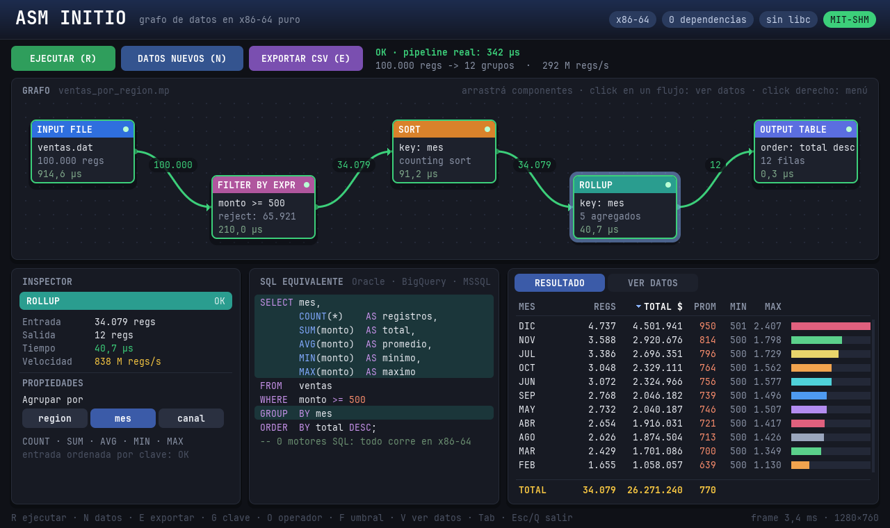
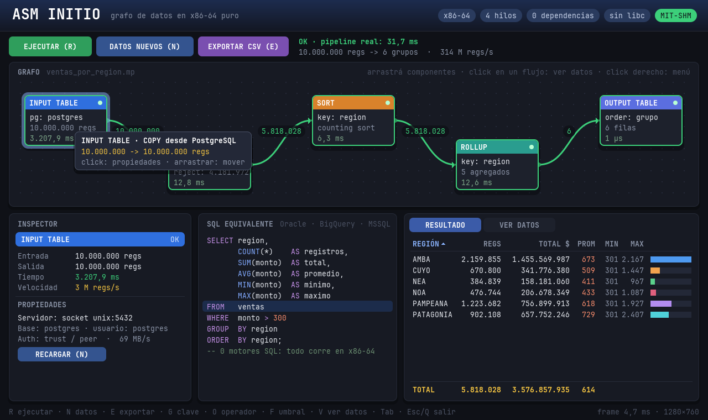
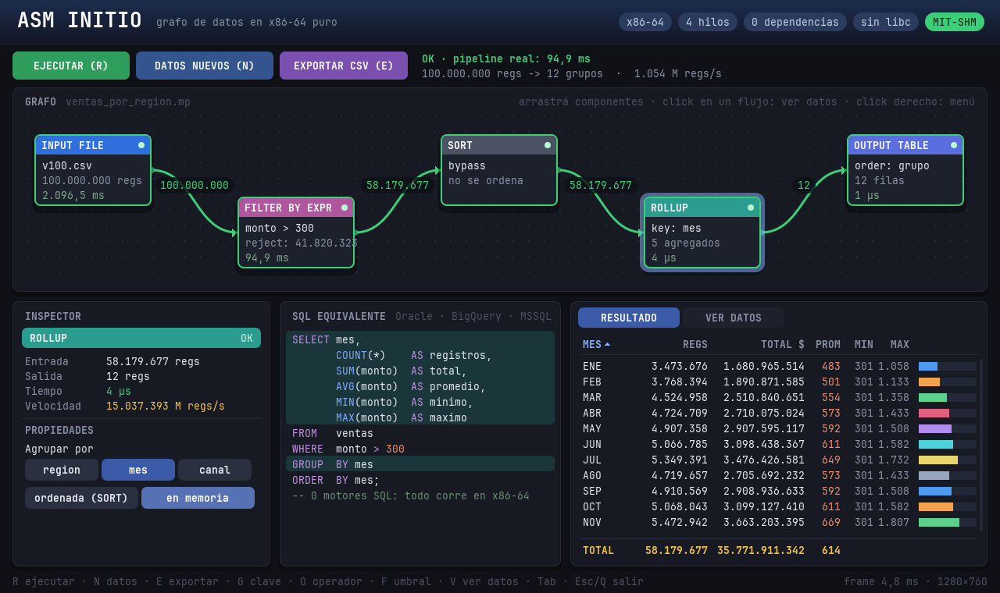

# ASM Initio

Un GDE de flujo de datos, al estilo de los grafos de Ab Initio, escrito **100 % en ensamblador x86-64** para Linux, con **cero dependencias**.



El grafo `INPUT → FILTER BY EXPRESSION → SORT → ROLLUP → OUTPUT TABLE` procesa hasta **200 millones de registros** de ventas (región, mes, canal y monto). Los datos pueden ser generados, venir de un **CSV** o de **PostgreSQL**. Los componentes se arrastran, sus propiedades se editan, se pueden ver los registros que pasan por cada flujo y el SQL equivalente se reescribe en vivo.

## Rendimiento

Misma consulta y mismos datos; todas las herramientas devuelven idénticos resultados. Detalle y metodología en [bench/RESULTADOS.md](bench/RESULTADOS.md).

| 100 M filas | Ya en memoria | Desde CSV (2,2 GB) |
|---|---:|---:|
| **ASM Initio** (4 hilos) | **~80 ms** | **2,1 s** |
| DuckDB 2.0 | 117 ms | 2,9 s |
| Polars 2.1 | 152 ms | 2,7 s |
| C `-O3` + OpenMP | 119 ms | — |
| pandas 3.0 | 2.911 ms | 13,6 s |

## Qué podés hacer

| | |
|---|---|
| **Arrastrar componentes** | Los flujos son curvas Bézier con antialiasing que los siguen. |
| **Inspector de propiedades** | Click en un componente para ver métricas (entrada, salida, tiempo y throughput medidos) y editar sus parámetros. |
| **Filtro editable** | Seis operadores (`>`, `>=`, `<`, `<=`, `=`, `!=`) y umbral con botones, rueda del mouse o tipeando el valor. |
| **Agrupar por** | Región, mes o canal. SORT y ROLLUP se reconfiguran juntos. |
| **Resultado** | COUNT, SUM, AVG, MIN y MAX por grupo, con barras. Click en un encabezado ordena por esa columna (asc/desc). |
| **Ver datos** | Click en un flujo para ver sus registros reales. Tiene scroll con rueda, PgUp/PgDn y una barra arrastrable. En el flujo ordenado se marcan los cortes de grupo. |
| **SQL vivo** | La consulta equivalente refleja operador, umbral, clave y orden, y resalta la cláusula del componente seleccionado. |
| **Exportar CSV** | Escribe `resultado.csv` con `open`/`write`/`close`. |
| **Más** | Menú contextual (click derecho), doble click para ver la salida, tooltips, notificaciones, ventana redimensionable. |

<p>


</p>

## Fuentes de datos

```sh
./build/asminitio                         # 1 M filas generadas (hasta 100 M desde la UI)
./build/asminitio --rows 200M             # cualquier cantidad hasta 200 M
./build/asminitio --csv ventas.csv        # CSV con , ; o TAB
PGHOST=127.0.0.1 PGUSER=yo PGPASSWORD=... PGDATABASE=dw \
  ./build/asminitio --pg "SELECT region, mes, canal, monto FROM ventas"
```

- **CSV:**
  - las columnas se reconocen por nombre: `region`/`zona`, `mes`/`month`, `canal`/`channel` y `monto`/`amount`/`importe`/`total`;
  - acepta comillas, BOM y `\r\n`;
  - se lee mapeado en memoria y se parsea en paralelo (unos 1,1 GB/s);
  - las categorías se codifican con diccionarios por hilo, hasta 63 valores distintos por columna más "(otros)".
- **PostgreSQL:** cliente nativo del protocolo v3, sin libpq.
  - Conecta por socket Unix o TCP a una IPv4 o `localhost`; no resuelve DNS.
  - Autentica con trust, password, md5 o **SCRAM-SHA-256**, verificando la firma del servidor. SHA-256, HMAC, PBKDF2, MD5 y base64 están escritos en ensamblador.
  - Trae los datos con `COPY (consulta) TO STDOUT (FORMAT csv)`.
- **Modo benchmark:** `--bench [N]` corre sin ventana e imprime los tiempos por etapa y el resultado. `--dump-csv` y `--dump-bin` vuelcan el dataset.

<p>


</p>

## Lo técnico

- **ELF estático sin libc, sin Xlib y sin loader dinámico.** Solo syscalls: `socket`, `connect`, `poll`, `read`, `write`, `mmap`, `shmget`, `shmat`, `clock_gettime`, `open`…
- **Protocolo X11 implementado a mano:**
  - handshake y autenticación `MIT-MAGIC-COOKIE-1` (lee `~/.Xauthority`);
  - `GetKeyboardMapping`, para que las teclas funcionen con cualquier layout;
  - `InternAtom`, `_NET_WM_NAME`, `WM_DELETE_WINDOW` y size hints;
  - cursores del sistema (`CreateGlyphCursor`);
  - eventos de teclado, mouse, arrastre y resize.
- **Extensión MIT-SHM:** el framebuffer es un segmento de memoria compartida con el servidor X (`ShmPutImage`, sincronizado con `ShmCompletion`). Si no está disponible, por ejemplo con un servidor remoto o en algunos contenedores, cae automáticamente a `PutImage` por franjas.
- **Render por software:**
  - alpha blending en dos canales por operación;
  - rectángulos redondeados con antialiasing (cobertura calculada con SSE);
  - curvas Bézier cúbicas en punto fijo, rasterizadas con una máscara de cobertura;
  - sombras, degradés y texto con alfa de 8 bits.
- **UI en modo inmediato:** cada frame se dibuja completo y registra sus zonas clickeables; los eventos se resuelven contra esa lista.
- **Pipeline paralelo** con hilos propios (`clone` + `futex`, sin pthreads), sobre columnas reservadas con `mmap`:
  - filtro *branchless* (`setcc` + suma), especializado por operador;
  - *counting sort* estable en paralelo, con posiciones por hilo y clave;
  - *rollup* sobre la entrada ordenada;
  - modo alternativo **ROLLUP en memoria**: agrega dentro del filtro y saltea el SORT, como la opción equivalente de Ab Initio;
  - cada etapa se mide por separado.
- **Generador determinístico por bloques:** produce el mismo dataset sin importar la cantidad de hilos.
- Resultados validados contra pandas, Polars, DuckDB, C y PostgreSQL.

## Compilar y ejecutar

Requisitos: solo `nasm` y `ld` (binutils).

```sh
cd asm-initio
make
./build/asminitio
```

Necesita un servidor X con visual TrueColor de 24/32 bits: Xorg, o XWayland en escritorios Wayland. En WSL2 funciona con WSLg.

## Teclado

| Tecla | Acción |
|---|---|
| `R` / `Enter` / `Espacio` | Ejecutar el grafo |
| `N` | Datos nuevos |
| `1` … `5` | 100K / 1M / 10M / 50M / 100M registros |
| `+` / `-` | Umbral del filtro |
| `F` | Tipear el umbral (`Enter` confirma, `Esc` cancela) |
| `O` | Siguiente operador del filtro |
| `G` | Siguiente clave de agrupación |
| `V` | Ver datos de salida del componente seleccionado |
| `Tab` / `←` `→` | Recorrer componentes |
| `↑` `↓` `PgUp` `PgDn` `Inicio` `Fin` | Desplazar tablas |
| `E` | Exportar CSV |
| `Esc` | Cerrar menú / deseleccionar / volver (sale si no hay nada abierto) |
| `Q` | Salir |

## Estructura

```
asm-initio/
├── src/main.asm    # entrada, bucle principal, datos y estado
├── src/threads.asm # hilos con clone/futex
├── src/csv.asm     # lector CSV paralelo con diccionarios
├── src/pg.asm      # cliente PostgreSQL (protocolo v3, SCRAM, md5)
├── src/crypto.asm  # SHA-256, HMAC, PBKDF2, MD5, base64
├── src/cli.asm     # argumentos, benchmark y volcados
├── bench/          # benchmark comparativo y resultados
├── src/x11.asm     # protocolo X11, auth, MIT-SHM, teclado, cursores
├── src/gfx.asm     # rasterizador: blending, AA, Bézier, texto
├── src/data.asm    # generador, pipeline, orden, exportación CSV
├── src/ui.asm      # hit testing, eventos, paneles y widgets
├── src/defs.inc    # constantes, layout y macros
├── src/font_*.bin  # glifos con alfa de 8 bits (incbin)
├── tools/genfont.py  # rasteriza JetBrains Mono (solo para regenerar fuentes)
└── Makefile
```

Las fuentes bitmap derivan de [JetBrains Mono](https://www.jetbrains.com/lp/mono/) (SIL Open Font License 1.1).
